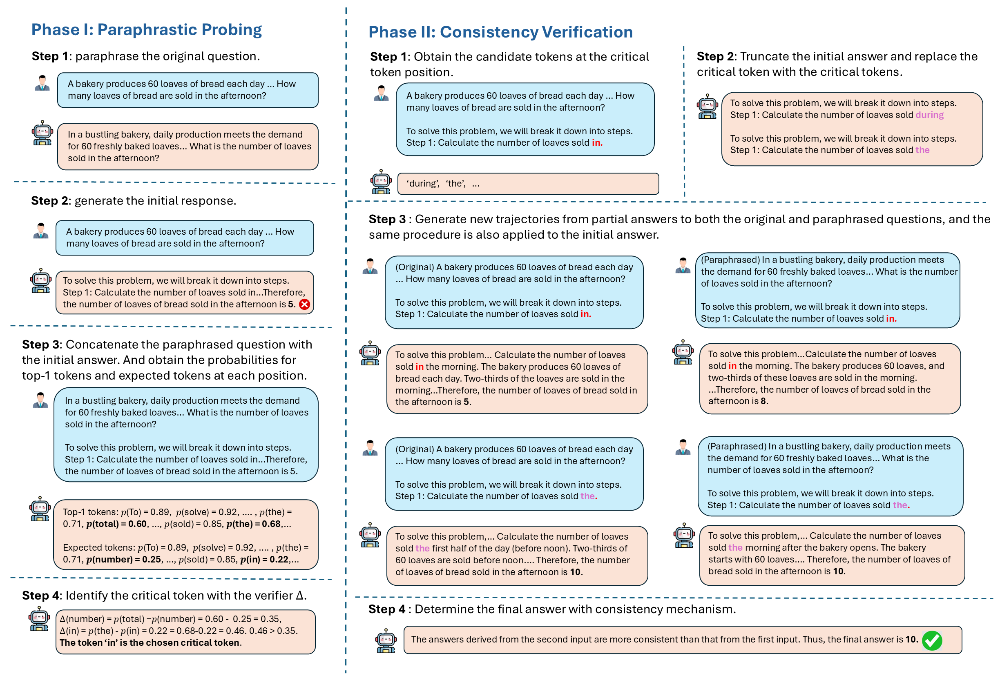

# PPCV

Source code for **[Finding the Cracks: Improving LLMs Reasoning with Paraphrastic Probing and Consistency Verification](https://arxiv.org/abs/2602.11361)**.

PPCV (Paraphrastic Probing and Consistency Verification) is an inference-time framework for improving LLM reasoning. It uses different phrasings of the same question to identify a critical token in an initial reasoning trajectory, explores alternative continuations at that position, and selects an answer by agreement across question variants. It requires no additional training or external process reward model.

## Framework



The paper presents two conceptual stages: paraphrastic probing and consistency verification. This repository implements them as three sequential steps:

1. **Generate paraphrases and an initial reasoning path.** Create meaning-preserving question variants and greedily generate a solution to the original question. Save the original question, its paraphrases, and the initial solution.
2. **Locate the critical token through paraphrastic probing.** Condition on each paraphrase and the initial reasoning prefix, then compare the predicted top-1 token with the token in the initial solution. Rank mismatched positions by the largest probability gap across paraphrases and retain the reasoning prefix before the selected position.
3. **Generate alternative continuations and verify consistency.** Append candidate next tokens from the model's top-K predictions and greedily continue each prefix for the original question and its paraphrases. Select the original-question answer with the most agreement across variants; use similarity-weighted agreement to break ties.

| Step | Mathematics | Science / multiple-choice reasoning | Main output |
| --- | --- | --- | --- |
| 1: Initial generation | `math_step1.py` | `sci_step1.py` | `question`, `ori_question_ans`, `answer` |
| 2: Critical-token probing | `math_step2.py` | `sci_step2.py` | Adds the truncated reasoning prefix, `part_ans` |
| 3: Continuation and verification | `math_step3.py` | `sci_step3.py` | Candidate continuations, selected prediction, and accuracy |

The math scripts request answers in `\boxed{}` and use `grade_predictive.py` for answer extraction and mathematical equivalence. The science pipeline requests `The answer is: (<option>)`; its final step extracts and compares option letters.

## Requirements

Use a Linux environment with NVIDIA CUDA GPUs that support the scripts' `bfloat16` configuration, and enough GPU memory for the selected model and context length. vLLM uses all visible GPUs through `tensor_parallel_size=torch.cuda.device_count()`; step 2 loads the causal language model with Transformers and automatic device placement. Step 3 also loads `all-MiniLM-L6-v2` on a GPU for similarity scoring.

```
vllm
Pytorch
transformers
accelerate
sentence-transformers
numpy
regex
sympy
```


## Datasets

Dataset inputs are JSON lists with at least `question` and `answer` fields:

Pass the filename prefix to `--dataset`: for example, `--dataset math500` reads `datasets/math500_test.json`. Included math datasets include `math500`, `gsm8k`, `gsmhard`, `svamp`, `amc2023`, `aime2024`, `aime2025`, `aime2026`, `brumo2025`, and `hmmt2025`. Science/multiple-choice datasets include `arc`. Filenames are case-sensitive.

## Run the code

After configuring the paths above, run the three steps in order. Set `CUDA_VISIBLE_DEVICES` to the GPUs allocated to your job if needed, and keep the same visible GPU configuration across steps.

### Mathematics

```bash
python math_step1.py --dataset math500 --topk 10 --seed 10 --model Qwen3-32B
python math_step2.py --dataset math500 --topk 10 --seed 10 --model Qwen3-32B
python math_step3.py --dataset math500 --topk 10 --seed 10 --model Qwen3-32B
```

Use the same `--dataset`, `--topk`, and `--seed` in all three commands. The intermediate and final results use the filename:

```text
qwen3_result_math500_top10_seed10.json
```

`--topk` controls the candidate-token count in step 3; in steps 1 and 2 it is used to name the result file. `--seed` sets the Python, NumPy, and PyTorch seeds in each math script.

### Science / multiple-choice reasoning

```bash
python sci_step1.py --dataset arc --topk 10 --seed 10 --model Qwen3-32B
python sci_step2.py --dataset arc --topk 10 --seed 10 --model Qwen3-32B
python sci_step3.py --dataset arc --topk 10 --seed 10 --model Qwen3-32B
```

The intermediate and final results use `result_arc.json`. Always specify the dataset explicitly: the science scripts' defaults differ. Only `sci_step3.py` accepts `--topk`; the science scripts do not expose a `--seed` argument.

### Outputs

Each step overwrites the same result file with its updated records. Preserve a copy after a step if you need its intermediate output, and avoid concurrent runs with the same output filename.

The final records contain `part_ans_critical_token` (candidate prefixes), `candidate_ans` (continuations by token candidate and question variant), `predictive_ans` (the selected reasoning trajectory), `gt_ans`, and `match_flag`. Step 3 prints **Match Accuracy** and appends an aggregate accuracy record to the JSON list. Timing and processing messages are written to `logg_<dataset>.txt`.

## Citation

```bibtex
@misc{shi2026findingcracks,
  title={Finding the Cracks: Improving LLMs Reasoning with Paraphrastic Probing and Consistency Verification},
  author={Weili Shi and Dongliang Guo and Lehan Yang and Tianlong Wang and Hanzhang Yuan and Sheng Li},
  year={2026},
  eprint={2602.11361},
  archivePrefix={arXiv},
  primaryClass={cs.CL},
  url={https://arxiv.org/abs/2602.11361}
}
```
